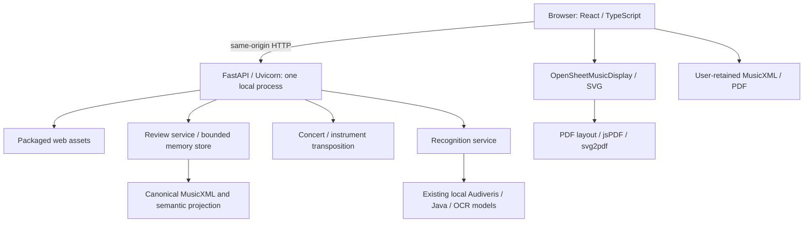

# Music Sheet Transposer 1.0 — Architecture

## Runtime

The launcher binds to 127.0.0.1 and serves built frontend and permitted APIs on one origin. No Node development server is needed after packaging. Python libraries are bundled; system Python and matching Ubuntu Linux ABI are required. Audiveris, Java and OCR models are external local prerequisites. Release 1.0 adds no cloud service, authentication or durable user storage.

## Source responsibilities

| Component | Source | Responsibility |
| --- | --- | --- |
| Workflow | frontend-v2/src/real/RealWorkspace.tsx | Active document, selection, revision, save gates and workspace actions |
| Rendering | RenderedScore.tsx | OSMD, note/object hit targets, overlays and measure selection |
| Key/sections | KeyShiftControl.tsx, SectionEditor.tsx | Explicit interval and non-mutating section preview |
| HTTP/PDF | api.ts, PDFSource.tsx, PDFExportDialog.tsx, scorePDF.tsx | Contracts, source display and rendered export |
| API | backend/app/api/v1 | Health, recognition, reviews and transposition |
| XML | backend/app/music/review/document.py, importer.py, patcher.py | Original bytes, XML, stable references and semantic projection |
| Relationships | ties.py, slurs.py, tuplet_work.py, sections.py | Ownership, notation scope and copy/transposition |
| Service/store | service.py, storage.py | Revision checks, atomic edits, history and expiry |
| Transposition | backend/app/music/musicxml | Notes, keys, chord roots/basses and instrument metadata |
| Recognition | backend/app/music/recognition | Provider execution, profiles, diagnostics and draft XML |
| Release | pilot-release/build_release_1_0.py, release_start.py | Baseline verification, integrity and loopback startup |

Frontend filenames without a full prefix are under frontend-v2/src/real/. Review filenames are under backend/app/music/review/. Legacy frontend/ is retired; historical pilot records are not the current architecture specification.

## Data and transactions

MusicXML is the editable interchange/persistence format. A review document retains original bytes separately from corrected XML and maps stable event/object references to XML nodes. The importer projects parts, measures, voices, events, lyrics, text and relationships. Editing patches XML through the service, not persisted SVG.

The service checks revision, clones the current document, applies a command, checks technical limits and stores a new revision/history entry under the store lock. Failed commands do not partially commit. Undo/Redo restores complete snapshots within bounded history. Reimport reconstructs references and supported relationship ownership from MusicXML.

Review states include DRAFT, REVIEW_REQUIRED and VERIFIED. VERIFIED is a technical state, not Product Owner acceptance. UI retained-file receipts are separate from server state.

## HTTP contracts

| Route | Purpose |
| --- | --- |
| GET /api/v1/health | Local process health |
| POST /api/v1/recognize | PDF/image to draft and diagnostics |
| POST /api/v1/reviews | Open MusicXML review |
| /api/v1/reviews/{id} | Read/release session and revision-scoped commands |
| POST .../{id}/sections/preview | Candidate projection without storage mutation |
| POST .../{id}/sections/append | Atomic complete-measure append |
| /api/v1/transpose/concert-key | Explicit source/mode/target; optional exact semitones |
| /api/v1/transpose/instrument | Independent written instrument MusicXML |

Section requests contain start/end measure IDs, source/target fifths, mode and signed semitones. Destination must agree with the interval. Preview validity includes review ID/revision and the entire request fingerprint. Apply rechecks server revision.

## Relationships and transposition

Section copy checks complete tie/slur/tuplet ownership, deep-copies measures, seeds inherited divisions/key/time/clef/staff context and remaps copied XML IDs and complete tie endpoints. Instrument metadata is temporarily separated and restored so written pitches are not transposed twice. Old measures and source Concert data remain unchanged.

The spelling engine transposes supported pitches, key changes and chord roots/basses while preserving rhythm/lyrics. Unsupported nontraditional/custom spellings are reported instead of silently normalized. Native notation and interaction overlays share score coordinates so accepted ties/hit targets follow zoom and reflow.

## Lifetime and limits

MemoryReviewStore runs in one process. Defaults include approximately one-hour lifetime, eight reviews, 128 MiB review budget, 20 history entries with an 8 MiB history budget and 100,000 XML nodes per review. Access/cleanup enforce expiry. These are bounds, not recovery guarantees.

Recognition defaults include 20 MiB uploads, ten pages, 120-second provider timeout and bounded XML/archive output. Audiveris may use local temporary working files. There is no permanent score database. Users retain MusicXML and reopen it after browser/process loss.

## Release boundary

The builder verifies accepted preview.5 file hashes and compares application source to that baseline. Only the version constant may differ for this promotion. It builds assets, copies unchanged backend/runtime, includes current English docs/receipts, hashes package files, checks ABI and creates tar.gz plus SHA-256. Existing output is never overwritten.

Tag v1.0.0 identifies release source; the manifest identifies packaged bytes. The accepted feature checkpoint is e8a6b24. Both source tag and archive checksum are retained. Old packages remain separate rollback targets. Cloud architecture and broad new notation work require future scope.
