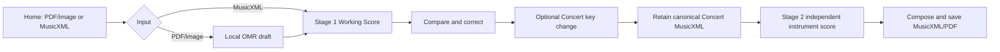

# Music Sheet Transposer 1.0 — Product and UX Design

## Purpose and authority

Release 1.0 is a local, user-controlled workspace for turning an existing score into editable MusicXML and independent instrument arrangements. The Product Owner accepted Advanced Editing v1 and preview.5 layout, then designated that final version as production 1.0. This release adds packaging, version consistency and documentation, not new musical behavior.

The Product Constitution and Acceptance Criteria remain authoritative. PC-01 treats OMR as recognition; PC-02/06 put user correction and intent first; PC-03/04 define the Concert-to-instrument handoff; PC-05/07 protect data and regressions; PC-08 reserves acceptance for the Product Owner.

## Workflow

Unchanged imported Concert MusicXML with sufficient key context can go directly to instrument generation. A changed Concert score must be saved before generating new instrument outputs. A PDF/image draft requires comparison and correction; confirmation relates to the current revision. Recognition failure offers explicit manual reconstruction rather than fabricated notes.

## Workspace layout

Home contains application identity, import and recognition profile. Editing commands appear after a score is opened. Document actions, Concert/instrument navigation, view selection and composition tools have separate roles. Original Source is read-only. Compare shows both panes with independent navigation; Edit Only hides the source without removing tools.

Selection, notes/rests, accidentals, dots, ties/slurs, Groups, Lyrics, Add Chord, Text, Add measure and correction tools are shared across active Concert and instrument workspaces. Context controls appear near the edited object. Inline lyrics follow the active score position and support verses. Dismissible notifications must not push the score down. The section dialog hides unrelated notifications while open.

## Editing rules

Users choose pitches, durations, accidentals, voices, lyrics, harmony and expressions. Original input is not silently rewritten. Optional Validate reports rhythm issues; it does not compose missing notes. Technical representation errors or unresolved relationships can prevent an operation that cannot be represented safely. Undo/Redo handles complete commands in the active workspace.

An explicit accidental follows notation scope in a measure for the same step/octave/staff until replaced or key context changes. Resolved tied chains keep matching pitch and preserve direction/duration; unrelated following-bar notes remain unchanged. Ambiguous or mismatched ties are reported rather than guessed. Small affects only the selected notehead, including a chord member.

Chord symbols are user-entered, editable and deletable; the system does not decide harmony. Verse and voice are different concepts. Lyrics attach to chosen events and verse numbers. OCR text misclassified as a direction can be deleted or explicitly reassigned.

## Concert Key

Compact controls contain Source key, Mode, signed interval, Destination and Direction. Source is prefilled and editable. Each minus/plus press is 0.5 tones (one semitone). Destination and Up/Down remain available. Same-key Down lowers one octave; explicit register shifts are possible. Unsupported spellings and out-of-range pitches are reported.

Source confirmation is explicit. Preview is read-only and does not change the working revision. It occupies a full-width row below the buttons, at a readable scale with internal scrolling. Apply transposes actual notes and supported chord symbols. Keep Original/Close cancels without committing a preview.

## Instrument design

Each instrument/direction is independent. Concert input remains read-only. Changing direction selects/generates that variant without another instrument click. Cached edits stay with their variant during the session. Users save instrument outputs separately.

| Instrument | Standard Up | Readable Down | Written-to-sounding identity |
| --- | --- | --- | --- |
| Alto E-flat | Concert +9 semitones | Concert −3 semitones | Sounds a major sixth below written pitch |
| Soprano B-flat | Concert +2 semitones | Concert −10 semitones | Sounds a major second below written pitch |
| Tenor B-flat | Concert +14 semitones | Concert +2 semitones | Sounds a major ninth below written pitch |

Tenor Down reads like Soprano Up but retains Tenor metadata, sounding one octave below Concert. Defaults are Alto Down, Soprano Up and Tenor Down. These are instrument written scores, not vocal tenor parts.

## Advanced Editing v1

Choose Key Change Section, select first/last complete measures directly or through From/Through, choose source/destination/interval, and Preview. Apply appends a transposed copy to the end. Original measures remain unchanged; the copy gets a destination key and double barline. Chord roots/basses transpose with notes. All voices in the one-part/one-staff range are included.

The floating dialog is compact and viewport-bounded. Its description is separate from Preview/Apply/Cancel. A preview is valid only for the exact request and revision; range/key changes invalidate it, including late responses. Apply is one atomic Undo/Redo step. PDF drafts must first be saved as corrected MusicXML.

Boundary ties/slurs/tuplets must be complete. Repeat/ending copying, arbitrary middle insertion, multipart expansion and new nested/cross-bar tuplets are excluded. No clipped relationships or missing content are inferred.

## Persistence, PDF and acceptance

Save/Save As persist MusicXML to the user's device through the available browser workflow. Users retain the result; a download receipt is not a remote backup. Home offers save, continue editing or explicit discard. A4 PDF fit-in-one-page trades scale for page count; multi-page output remains available.

Acceptance covers direct editing in both stages/views, Undo/Redo identity, saved-key reimport, instrument independence, section append, readable preview and MusicXML/PDF output. Test results support technical verification; explicit Product Owner acceptance and production designation are recorded separately.
